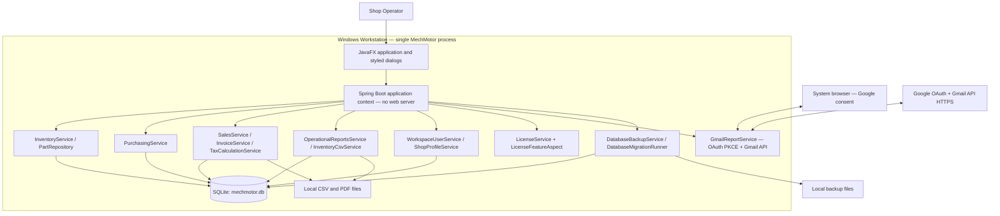
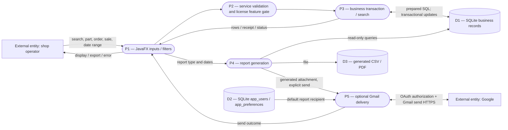
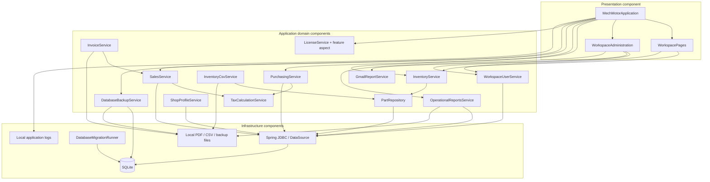
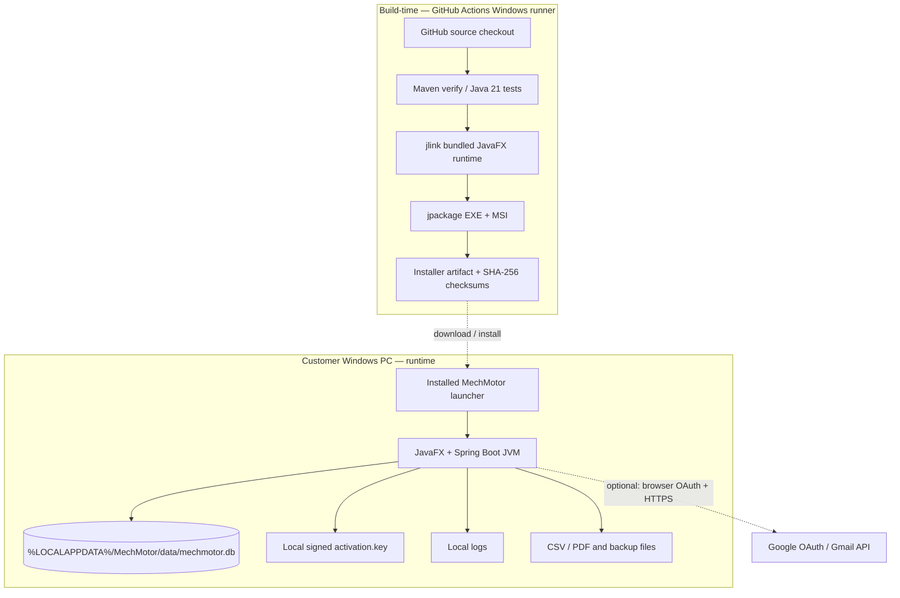

# MechMotor High-Level Design (HLD)

**System boundary:** Offline-first Windows desktop application on one workstation. JavaFX and Spring Boot operate in the **same process**, with `spring.main.web-application-type=none`. There are **no internal REST/gRPC services or broker queues**. Gmail communication is the only modeled external network integration for report mail; Google OAuth requires a browser and loopback callback. SQLite is local, not a shared network database.

**Diagrams:** HLD-01 system architecture; HLD-02 data flow; HLD-03 components and deployment; HLD-04 infrastructure/deployment boundaries. Requirement traceability: [REQUIREMENTS.md](REQUIREMENTS.md). Fine-grained designs: [LLD.md](LLD.md). Existing design notes: [../docs/HLD.md](../docs/HLD.md).

## HLD-01 — System architecture diagram

**Communication contracts:** UI invokes Java/Spring-managed services in-process; repositories use SQL over JDBC; Gmail uses outbound HTTPS and local browser OAuth; file exports use local filesystem. There is no RPC boundary between Java services. **FR-01 to FR-11, NFR-01, NFR-04, NFR-11.**

## HLD-02 — High-level data-flow diagram (DFD)

**Data stores:** D1 and D2 are logical partitions of the same physical SQLite file; D3 is filesystem output, **not** a separate database. The Send action generates a new report before delivery, and Gmail failure must not alter sales or stock. **FR-02/04/05/07/08/09, NFR-02/04/06.**

## HLD-03 — Component diagram

Connections show principal ownership and dependency direction, not every call edge. Class/interface details are in LLD-01. **NFR-02/03/09/10.**

## HLD-04 — Deployment / infrastructure diagram

**Not present:** load balancer, CDN, Kubernetes cluster, container orchestration, queue, remotely hosted primary database or backend HTTP API. The *future* optional report scheduler is not depicted as currently deployed. Windows EXE/MSI signature and SmartScreen reputation depend on a trusted code-signing identity; the activation-signing key is unrelated. **NFR-01/05/08/09/11.**

## Technology and choices

| Concern | Actual choice | Trade-off |
|---|---|---|
| UI | JavaFX 21 controls and CSS | Native desktop UI; visual QA needed across DPI scales |
| Runtime | Java 21, Spring Boot 3.5.5 without web server | In-process DI; no distributed-service operational overhead |
| Data | SQLite, Spring JDBC | Local transactional store; not designed for simultaneous multi-PC network sharing |
| Reporting | PDFBox 3, CSV via Java code | Local generation; Gmail only when authorized |
| Identity | Ed25519 activation signature; local user directory | License validation exists; directory roles do not enforce authentication |
| Deployment | Maven, GitHub Actions, jlink, jpackage | Single-machine installs, no autoscaling |
| Future expansion | A server/API/queue would require new requirements and design | Must **not** be represented as currently built |

## Quality gates and open work

- Preserve schema migrations and transactional stock checks; run tests after each change.
- Run end-to-end first-run/expired-license, Gmail-consent and recipient-routing tests on a real Windows PC.
- Validate visual layout, Settings tab click behavior, accessibility and high-DPI scaling against approved screenshots.
- Benchmark representative shop inventory sizes; do not claim measured p95 or throughput without evidence.
- Exercise restore drills and verify Windows package signing separately from activation signing.
