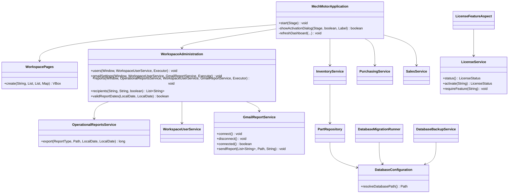
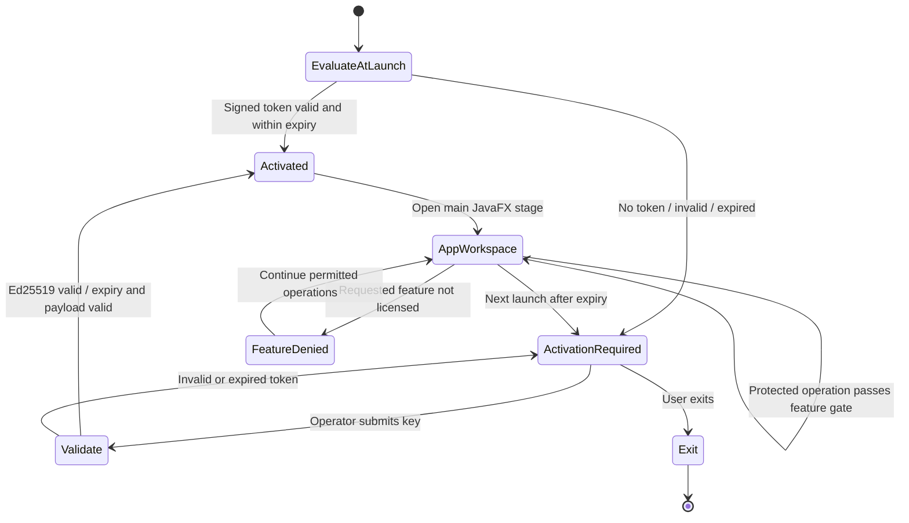
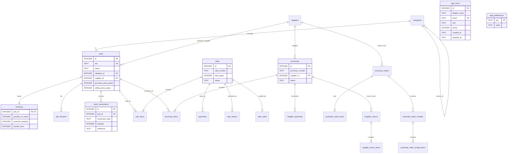
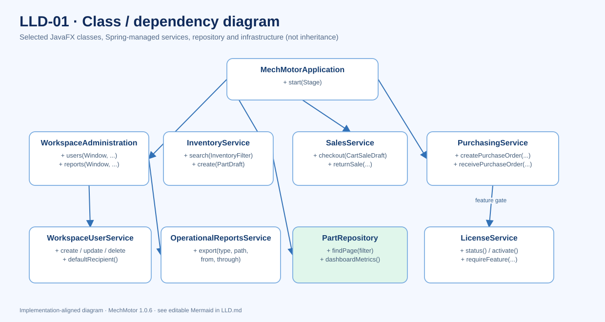
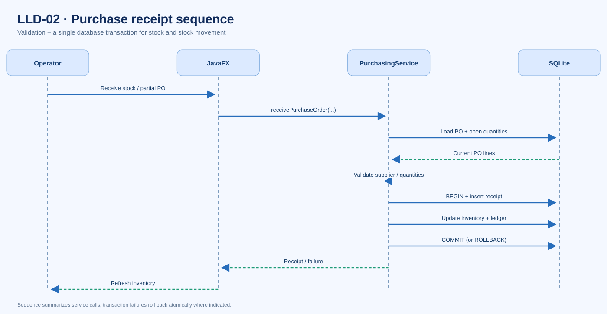
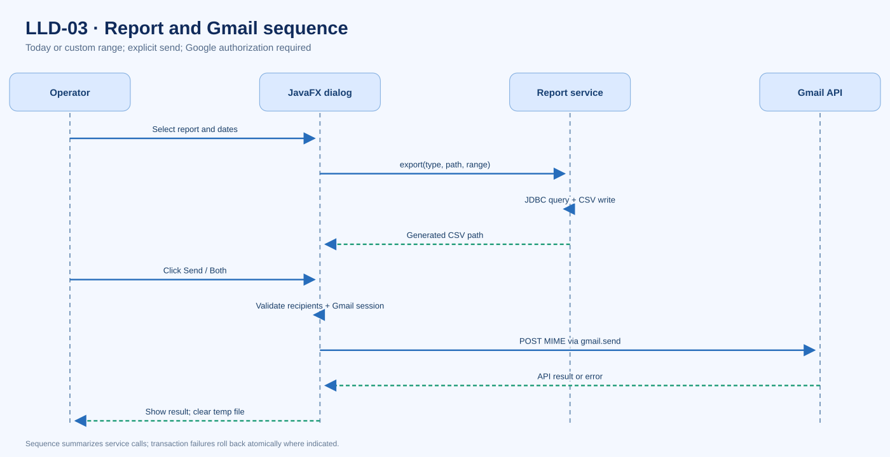
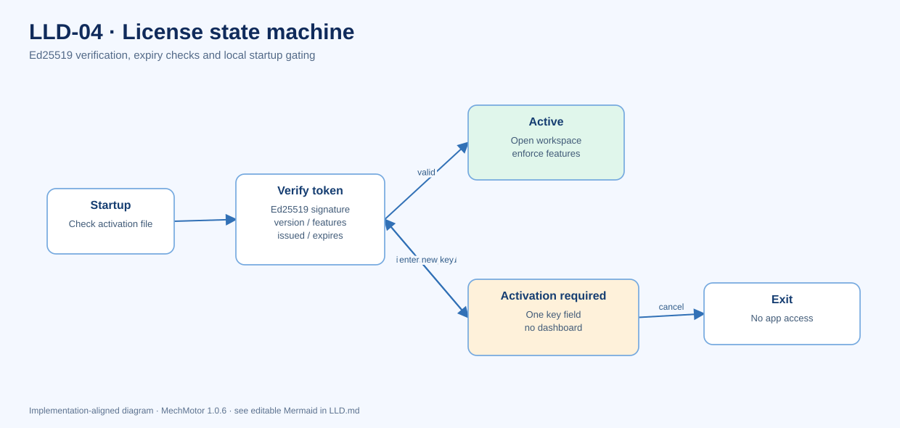
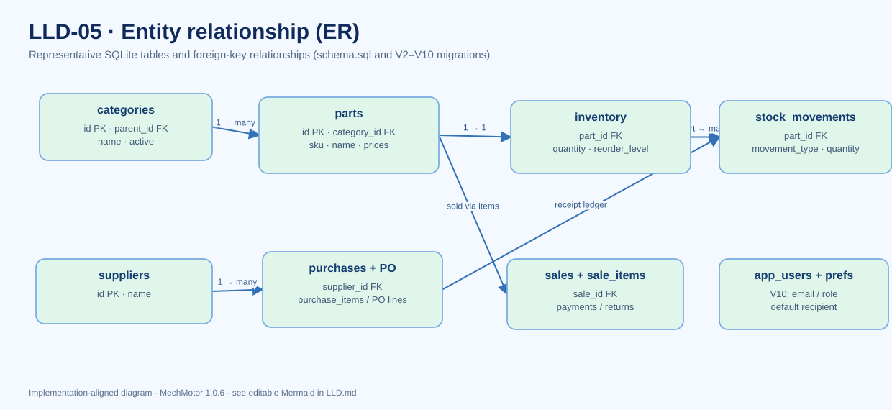

# MechMotor Low-Level Design (LLD)

This document maps source-level objects and algorithms to the offline-first architecture in [HLD.md](HLD.md) and the requirements in [REQUIREMENTS.md](REQUIREMENTS.md). It complements—not replaces—[../docs/LLD.md](../docs/LLD.md). All diagrams are editable Mermaid embedded in Markdown.

## LLD-01 — Class diagram



Relationships are simplified source dependency associations; not inheritance claims. Spring creates managed service instances; JavaFX constructs UI nodes. `Part`, `PartDraft`, `InventoryFilter`, `PurchaseOrderDraft` and `SaleDraft` are domain records passed between layers. No REST controllers or API DTO contracts are required by this desktop-only release. **FR-01/02/04/05/07/08/09, NFR-06/12.**

## LLD-02 — Sequence diagram: purchase receipt and stock-ledger transaction

```mermaid
sequenceDiagram
    actor Operator
    participant UI as JavaFX UI
    participant Service as PurchasingService
    participant License as LicenseFeatureAspect
    participant DB as SQLite / JDBC
    Operator->>UI: Enter supplier and received quantities
    UI->>Service: Receive / post purchase
    Service->>License: Service-level feature check (Spring AOP)
    License-->>Service: Allowed or reject
    Service->>Service: Validate quantities, references and balances
    Service->>DB: BEGIN transaction
    Service->>DB: Insert purchase and line snapshots
    Service->>DB: Update inventory quantity and cost
    Service->>DB: Insert stock movements / receipt links
    alt Any validation, constraint or SQL failure
      DB-->>Service: Failure
      Service->>DB: ROLLBACK
      Service-->>UI: Error; stock unchanged
    else Transaction succeeds
      Service->>DB: COMMIT
      Service-->>UI: Receipt / updated quantities
    end
    UI-->>Operator: Refresh inventory and receipt status
```

**Invariant:** Stock, receipt rows, cost snapshots and ledger movements must remain consistent through one transaction; formal PO partial receiving additionally checks remaining quantities. Supplier payments are bookkeeping, not bank transfers. Same transaction principle applies to sales, voids and returns. **FR-04/05/06, NFR-02.**

## LLD-03 — Sequence diagram: report generation and Gmail send

```mermaid
sequenceDiagram
    actor Operator
    participant UI as WorkspaceAdministration
    participant Pref as WorkspaceUserService
    participant Report as OperationalReportsService
    participant CSV as Local filesystem
    participant Gmail as GmailReportService
    participant Browser as System browser
    participant Google as Google OAuth + Gmail API
    opt Google account not yet connected (explicit action)
      Operator->>UI: Connect Google in Settings
      UI->>Gmail: connect()
      Gmail->>Browser: Open OAuth authorization URL (PKCE + state)
      Browser->>Google: Authorize gmail.send scope
      Google-->>Gmail: Local loopback callback / authorization code
      Gmail->>Google: HTTPS token exchange
      Google-->>Gmail: Short-lived access token (memory only)
    end
    Operator->>UI: Report type + Today/custom dates + email + Both
    UI->>UI: Validate dates (max 366 days)
    UI->>Pref: Load default recipient
    Pref-->>UI: Default email
    UI->>UI: Validate and deduplicate destination emails
    alt Generate and download
      UI->>Report: export(type, destination, from, to)
      Report->>CSV: Write CSV
      CSV-->>Operator: Local downloadable file
    else Send or generate-and-send-both
      Operator->>UI: Confirm recipients
      UI->>Report: export(type, temporary CSV, from, to)
      Report->>CSV: Write temporary file
      UI->>Gmail: sendReport(recipients, file, name)
      Gmail->>Google: HTTPS Gmail API send
      Google-->>Gmail: Success / failure
      Gmail-->>UI: Delivery accepted or error
      UI->>CSV: Remove temporary CSV
      UI-->>Operator: Outcome; do not claim delivery on error
    end
```

**Behavior:** Today is default. Entered address overrides default unless Both is checked; Both requires configured recipients and deduplicates them. Send generates a fresh report. The report UI contains three actions, but on the present mainline the Reports page shortcuts invoke a common modal; they are not three separate native workflows until the modal selection is applied. Email requires internet and valid OAuth client configuration; no unattended scheduling is provided. **FR-07/08/12, NFR-04/06.**

## LLD-04 — License state machine diagram



**Critical safeguards:** Only the public verification key is packaged. Issuer private key stays outside Git and installer. Local activation is not user login or a server lease. Expiry and feature enforcement are per license status; token may be reused on another PC because this release does not bind to machine hardware. Local privileged attacker resistance is limited. **FR-01, NFR-03.**

## LLD-05 — Entity-relationship diagram (current schema, selected relationships)



The diagram intentionally shows major relationships and selected fields, **not** every column, index or constraint. Canonical definitions are in `src/main/resources/schema.sql` and `src/main/resources/db/migration/V2__*.sql` through `V10__*.sql`. `app_users` roles are metadata; they are not FK-linked to sales/purchases because actual user authentication/attribution is not implemented. `app_preferences` holds local options such as default recipient, not OAuth credentials. **FR-02/04/05/06/09, NFR-02/04/12.**

## Detailed behavior and design patterns

| Area | Approach | Evidence / limits |
|---|---|---|
| Dependency injection | Spring singleton services by default, constructor injection | Service classes annotated `@Service`; not a custom Singleton implementation |
| Transactions | Spring-managed transactions for stock-affecting writes | Services use transaction boundaries plus SQLite constraints |
| Repository | `PartRepository` for prepared inventory SQL | No generalized ORM/entity manager |
| Validation | Immutable domain records and service-level checks | Invalid date ranges, email inputs, stock quantities rejected |
| Authorization | Spring AOP `@RequiresFeature` feature gate | License entitlements, **not** user RBAC |
| UI concurrency | JavaFX `Platform.runLater` + background executor | Network and DB tasks moved off UI thread |
| Reporting | Date-bounded query/export and transient attachment | Gmail send-only OAuth; token in process memory |
| Schema evolution | Versioned migration runner with fail-closed behavior | Do not edit old migration files after shipping |
| Data recovery | Integrity-checked SQLite backup and restore | Test on separate copy and protect backup data |

## API and protocol contracts

There is **no published server REST/gRPC API**. The relevant contracts are internal Java method calls, JDBC SQL, and Google's remote OAuth/Gmail HTTPS endpoints. Do not add a fictitious `/api/users`, payment gateway, queue or Kubernetes deployment to these diagrams without first implementing and testing them.

## LLD test and operational checklist

- Validate purchases/sales/returns produce matching stock and audit records; rollback on failure.
- Test key expiration, signature tampering, feature denial and startup behavior.
- Test user validation, unique email and intentional deletion.
- Test Today vs custom range, invalid dates, default/given/Both email selection and Gmail errors.
- Confirm application never reveals stored license key on dashboard or Settings.
- Confirm migrations preserve existing shop records and backup restore integrity.
- Run `mvn --batch-mode clean verify`; Windows EXE/MSI installation tests; and manual DPI/accessibility/visual checks.


---

## LLD diagram image gallery (SVG)

### LLD-01 · Class Diagram



[Open image](diagrams/LLD-01-class-diagram.svg) · [Editable Mermaid source](LLD.md)

### LLD-02 · Purchase Sequence



[Open image](diagrams/LLD-02-purchasing-sequence.svg) · [Editable Mermaid source](LLD.md)

### LLD-03 · Gmail Reporting Sequence



[Open image](diagrams/LLD-03-gmail-report-sequence.svg) · [Editable Mermaid source](LLD.md)

### LLD-04 · License State Machine



[Open image](diagrams/LLD-04-license-state-machine.svg) · [Editable Mermaid source](LLD.md)

### LLD-05 · ER Diagram



[Open image](diagrams/LLD-05-entity-relationship.svg) · [Editable Mermaid source](LLD.md)


## JavaFX Settings navigation (premium desktop UI)

The `WorkspacePages.create("Settings", ...)` screen implements five selectable `ToggleButton` tabs in one `ToggleGroup`: **General**, **Email & Reports**, **Users & Roles**, **Notifications**, **Security**. Selecting a tab replaces only the tab content, updates the selected style, and preserves the application shell. The tab group guards against clearing the current selection. Buttons on the card panels dispatch through the existing application action map.

| Tab | Backed by | Intentionally unsupported |
|---|---|---|
| General | `ShopProfileService`, `LicenseService` (status/expiry only) | Showing or revealing stored activation key |
| Email & Reports | `GmailReportService`, `WorkspaceUserService.defaultRecipient`, `OperationalReportsService` | Background unattended email scheduling |
| Users & Roles | `WorkspaceUserService` directory operations | Enforced user authentication and authorization |
| Notifications | Existing dashboard low-stock summary and manual reporting guidance | Automatic email/push notifications |
| Security | `DatabaseBackupService` backup and restore | Configurable timeout or two-factor login |

**Acceptance:** all five tabs respond to mouse and keyboard activation; one tab stays visibly selected; switching tabs does not reset the database, force activation, or invoke a network call; every action opens its supported service dialog; the Settings screen remains legible at 100% and 125% Windows scaling. This is a UI routing change only and does not introduce role-based authentication or scheduled notifications.
