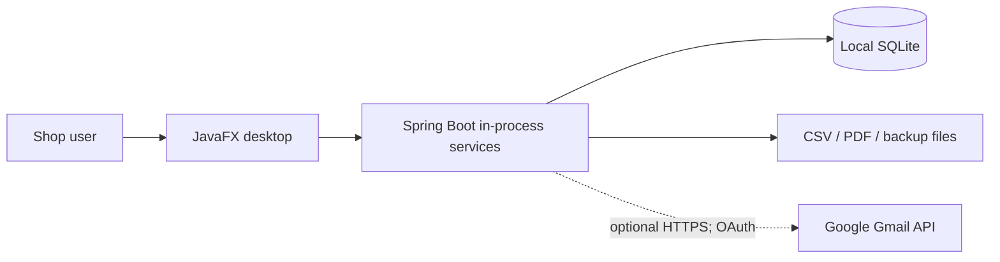

# Architechture Design — MechMotor

This folder contains **source-aligned** High-Level Design, Low-Level Design, functional and non-functional requirements for the current MechMotor Windows desktop implementation.

> The folder is intentionally named **`Architechture Design`** to match the requested repository path. The standard English spelling is *Architecture Design*.

## Documents

| Document | Contents |
|---|---|
| [REQUIREMENTS.md](REQUIREMENTS.md) | Functional requirements FR-01..FR-12; non-functional requirements NFR-01..NFR-12; implementation status, evidence and diagram mapping |
| [HLD.md](HLD.md) | HLD-01 System Architecture, HLD-02 High-Level Data Flow (DFD), HLD-03 Component Diagram, HLD-04 Deployment/Infrastructure |
| [LLD.md](LLD.md) | LLD-01 Class, LLD-02 Purchase Sequence, LLD-03 Gmail/Reports Sequence, LLD-04 License State Machine, LLD-05 Entity Relationship (ER) |

There are **nine editable Mermaid diagrams and nine standalone SVG images** (the eight requested types, with two sequence diagrams). The Markdown diagrams are authoritative; after edits, regenerate their corresponding SVG assets and confirm that both remain aligned.

## Architecture overview

**Deployment truth:** One Windows computer, one local SQLite database, no internal web server, no load balancer/CDN/message queue/Kubernetes. Payment flows record business events only and do not transfer funds. Gmail sends are optional and require Google authorization. Application roles are directory labels, not enforced RBAC.

## How to maintain

1. Update [REQUIREMENTS.md](REQUIREMENTS.md) before adding major behavior or non-functional promises.
2. Edit HLD for new components, data stores, network boundaries or deployment topology.
3. Edit LLD for class/service contracts, transactions, state machines, schemas and sequences.
4. Sync the original [../docs/HLD.md](../docs/HLD.md) and [../docs/LLD.md](../docs/LLD.md), keeping detailed design history.
5. Run Java tests and Windows packaging acceptance. Validate any claim of performance, scale, restore or email delivery with evidence.

## Code reference

- Source: `src/main/java/com/mechmotor`
- Schema: `src/main/resources/schema.sql` and `src/main/resources/db/migration`
- Build: `pom.xml`
- Windows: `.github/workflows/windows-package.yml`
- Existing design and readiness notes: `docs/`

This is documentation only; it adds no new backend API, role-enforcement feature, scheduled job or deployment environment.

## SVG image gallery

### HLD visuals

- [HLD-01 · System Architecture](diagrams/HLD-01-system-architecture.svg)
- [HLD-02 · High-Level Data Flow (DFD)](diagrams/HLD-02-high-level-dfd.svg)
- [HLD-03 · Component Diagram](diagrams/HLD-03-component-diagram.svg)
- [HLD-04 · Deployment Diagram](diagrams/HLD-04-deployment-diagram.svg)

### LLD visuals

- [LLD-01 · Class Diagram](diagrams/LLD-01-class-diagram.svg)
- [LLD-02 · Purchase Sequence](diagrams/LLD-02-purchasing-sequence.svg)
- [LLD-03 · Gmail Reporting Sequence](diagrams/LLD-03-gmail-report-sequence.svg)
- [LLD-04 · License State Machine](diagrams/LLD-04-license-state-machine.svg)
- [LLD-05 · ER Diagram](diagrams/LLD-05-entity-relationship.svg)

The SVG files are viewable without a Mermaid renderer. Keep each SVG synchronized with its Mermaid definition during architecture review.
