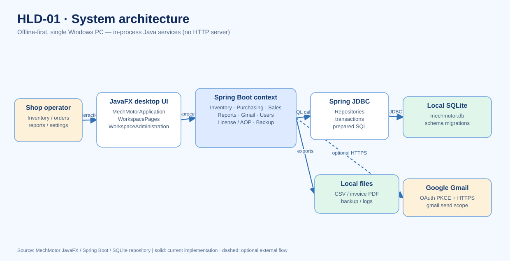
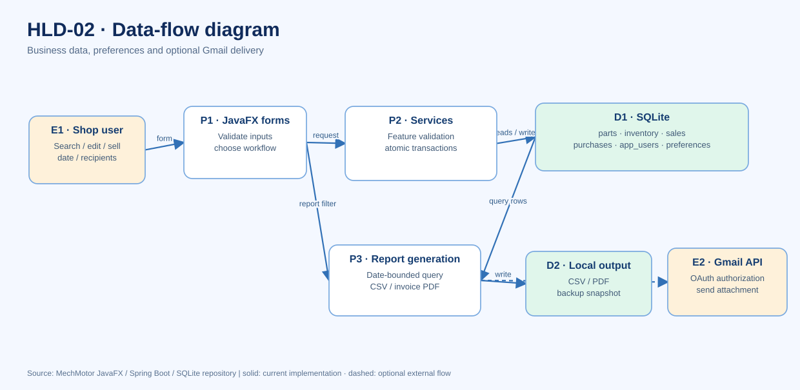
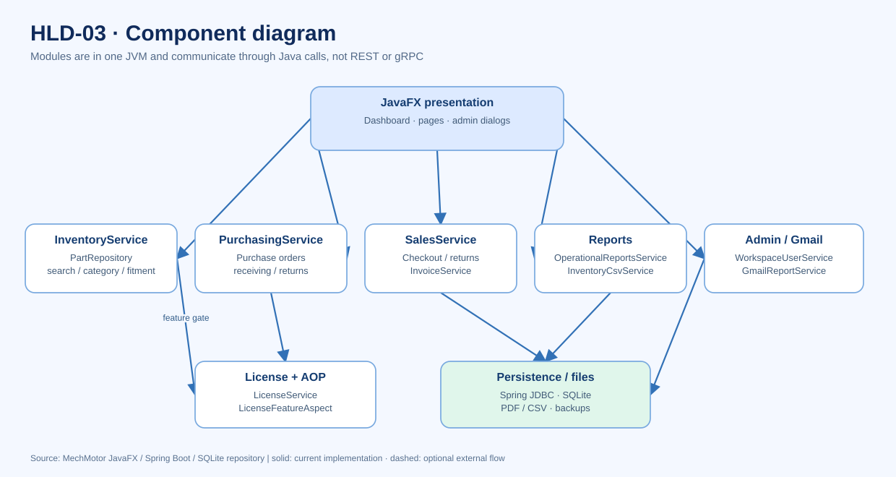
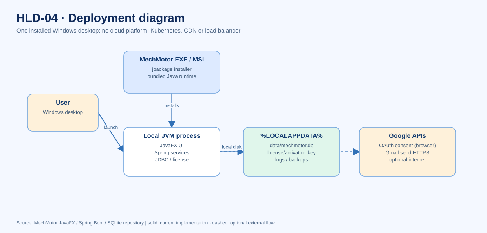

# MechMotor — Functional and Non-Functional Requirements

> **Scope:** Current Java 21 / JavaFX / Spring Boot / Spring JDBC / SQLite single-Windows-PC application, per source under `src/main`. This document distinguishes **implemented**, **partial**, and **planned** functionality. The diagrams in [HLD.md](HLD.md) and [LLD.md](LLD.md) trace these requirements to actual components and workflows.

## Functional requirements

| ID | Requirement | Status | Implementation / evidence | Diagram |
|---|---|---|---|---|
| FR-01 | Activate with signed Ed25519 license; validate expiry and feature grants before protected operations | Implemented | `LicenseService`, `LicenseFeatureAspect`, application startup | HLD-01, HLD-02, LLD-03, LLD-04 |
| FR-02 | Search, add, edit and deactivate parts; filter, sort, page and manage inventory quantity | Implemented | `MechMotorApplication`, `InventoryService`, `PartRepository` | HLD-01, HLD-02, LLD-01, LLD-02 |
| FR-03 | Manage categories, fitments and suppliers; save inventory views | Implemented | `InventoryService`, `PartRepository`, domain records | HLD-03, LLD-05 |
| FR-04 | Purchase and receive stock, create formal POs, support partial receiving, supplier payments/returns | Implemented with restrictions | `PurchasingService`; supplier credit carry-forward not implemented | HLD-02, LLD-02, LLD-04, LLD-05 |
| FR-05 | Sell parts, record payment, issue invoice PDFs, void sales and process partial returns | Implemented; bank/UPI/card settlement external | `SalesService`, `InvoiceService`, `TaxCalculationService` | HLD-02, LLD-02, LLD-05 |
| FR-06 | Maintain inventory stock movements and immutable/auditable transaction references | Implemented for supported operations | `stock_movements`, purchases/sales/returns; transaction services | LLD-02, LLD-05 |
| FR-07 | Generate operational CSV reports using selected dates (today by default); export invoice PDFs | Implemented | `OperationalReportsService`, `WorkspaceAdministration`, `InvoiceService` | HLD-02, LLD-03 |
| FR-08 | Connect Google via installed-app OAuth 2.0 PKCE, set default recipient, generate/send report to entered/default/both recipients | Implemented with external dependency | `GmailReportService`, `WorkspaceUserService`, `WorkspaceAdministration`; needs Google OAuth configuration and internet | HLD-01, HLD-02, LLD-03 |
| FR-09 | Maintain local users and directory roles; create/update/deactivate/delete | Implemented directory; **not** application login authorization | `WorkspaceUserService`, `app_users` | HLD-02, LLD-01, LLD-05 |
| FR-10 | Edit shop profile/tax settings; SQLite backup and restore | Implemented | `ShopProfileService`, `DatabaseBackupService` | HLD-03, LLD-05 |
| FR-11 | Consistent navigable JavaFX desktop pages and dialogs | Partially implemented | `MechMotorApplication`, `WorkspacePages`, `WorkspaceAdministration`; some UI tabs are currently static labels | HLD-01, LLD-01 |
| FR-12 | Schedule recurring Gmail reports and maintain delivery history | **Planned; not implemented as unattended scheduler** | Existing on-demand Gmail delivery is not a scheduler | HLD-04 (future boundary only) |

## Non-functional requirements

| ID | Quality attribute / constraint | Requirement and acceptance evidence | Present status | Diagram |
|---|---|---|---|---|
| NFR-01 | Offline-first availability | Inventory, sales, purchases, license checks and local reports must work without Google/network connectivity | Architectural behavior; physical-offline acceptance still needed | HLD-01, HLD-04 |
| NFR-02 | Data integrity | Monetary units stored as integer paise; stock-affecting writes atomic; no overselling/over-receiving; foreign keys active | SQL constraints, Spring transactions and tests; reconcile on representative data | HLD-02, LLD-02, LLD-05 |
| NFR-03 | Security & licensing | Ed25519 signature verification; signing private key kept outside repository/installer; feature checks enforced in services | Implemented; local privileged attacker remains threat | HLD-03, LLD-04 |
| NFR-04 | OAuth privacy | Gmail `gmail.send` scope only; OAuth PKCE and localhost callback; access token memory-only; no stored refresh token | Implemented; live Google OAuth integration validation required | HLD-01, LLD-03 |
| NFR-05 | Recoverability | Database outside install directory; integrity-checked backup, pre-restore copy, migrations fail closed | Implemented; regular restore drills recommended | HLD-03, LLD-04 |
| NFR-06 | Responsiveness | Disk/SQL/network work must not block JavaFX application thread; use background executors and bounded results | Implemented patterns; performance target needs measurement | HLD-02, LLD-03 |
| NFR-07 | Performance | Search paged and sort allowlisted; benchmark real catalogs and validate query plans; no unverified throughput/latency SLO | Implemented pagination; benchmark pending | HLD-02, LLD-01 |
| NFR-08 | Installability | Package Java runtime via `jlink` and EXE/MSI via `jpackage`; preserve user DB through upgrade | GitHub Actions builds and checks install/launch/uninstall; on-device QA remains | HLD-03 |
| NFR-09 | Testability | JUnit service/integration tests, Java CI, CodeQL and Windows package workflow | Existing workflows and tests; not equivalent to production acceptance | HLD-03 |
| NFR-10 | Operability | Local logs, SQLite schema migrations and clear errors; no server-side observability stack required | Local logs and versioned migrations implemented | HLD-03 |
| NFR-11 | Deployment topology | Initial release is one Windows PC/one SQLite DB; **no REST/gRPC, queue, load balancer, CDN or Kubernetes** | Confirmed via `WebApplicationType.NONE` and local datasource | HLD-01, HLD-03 |
| NFR-12 | Authorization | Directory roles must not be treated as enforced access controls | **Gap:** role labels exist without access-control enforcement | LLD-01 |

## Design-to-code change control

When adding a module: assign a functional requirement ID; identify a non-functional guardrail; update the corresponding HLD/LLD diagram and SQLite schema/migration details; add tests; update implementation status. Avoid claiming planned distributed components or scheduling infrastructure as deployed.

**Reference files:** `pom.xml`, `src/main/resources/application.properties`, `src/main/resources/schema.sql`, `src/main/resources/db/migration/V*.sql`, `src/main/java/com/mechmotor`, `docs/HLD.md`, and `docs/LLD.md`.

---

## Requirements-to-diagram image reference

All visualizations are illustrative views of the implementation; IDs in the matrices above are the requirement traceability record.

### Functional requirements — visual architecture and workflows

### HLD-01 · System Architecture

[Open image](diagrams/HLD-01-system-architecture.svg) · [Editable Mermaid source](HLD.md)

### HLD-02 · High-Level Data Flow (DFD)

[Open image](diagrams/HLD-02-high-level-dfd.svg) · [Editable Mermaid source](HLD.md)

### LLD-02 · Purchase Sequence

[Open image](diagrams/LLD-02-purchasing-sequence.svg) · [Editable Mermaid source](LLD.md)

### LLD-03 · Gmail Reporting Sequence

[Open image](diagrams/LLD-03-gmail-report-sequence.svg) · [Editable Mermaid source](LLD.md)

### LLD-04 · License State Machine

[Open image](diagrams/LLD-04-license-state-machine.svg) · [Editable Mermaid source](LLD.md)

### LLD-05 · ER Diagram

[Open image](diagrams/LLD-05-entity-relationship.svg) · [Editable Mermaid source](LLD.md)

### Non-functional requirements — deployment, boundaries, dependencies and recoverability

### HLD-03 · Component Diagram

[Open image](diagrams/HLD-03-component-diagram.svg) · [Editable Mermaid source](HLD.md)

### HLD-04 · Deployment Diagram

[Open image](diagrams/HLD-04-deployment-diagram.svg) · [Editable Mermaid source](HLD.md)

### LLD-01 · Class Diagram

[Open image](diagrams/LLD-01-class-diagram.svg) · [Editable Mermaid source](LLD.md)

> Quality claims such as performance, high availability, cloud scaling or Gmail delivery success require measured evidence. This offline desktop application does not presently use REST/gRPC between services, a message broker, a CDN, a load balancer or Kubernetes.
